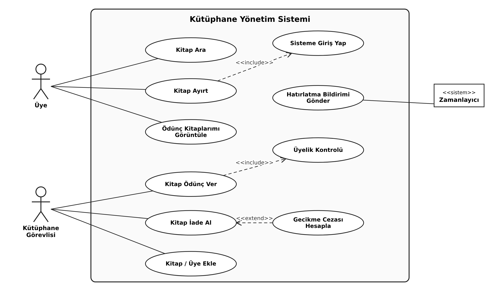
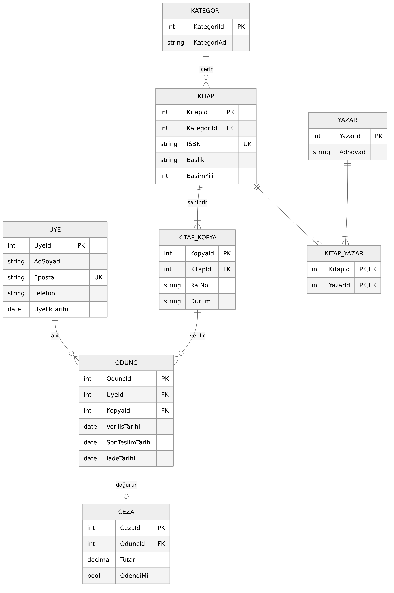
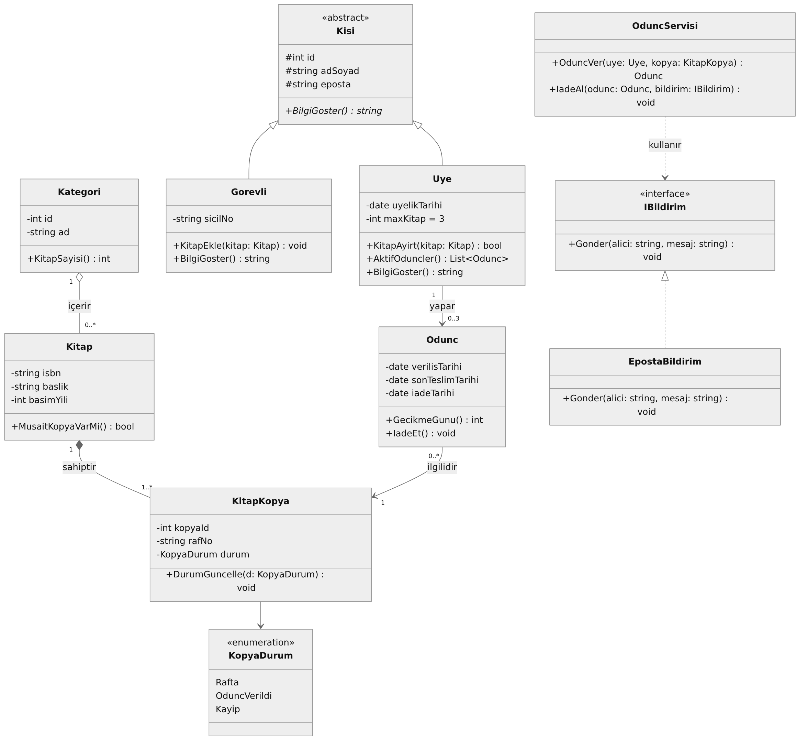

# Ders Ödevleri

| | |
|---|---|
| **Öğrenci** | Furkan Koyuncu |
| **Öğrenci No** | 256001029 |
| **Öğretim Görevlisi** | Öğr. Gör. Mehmet Can HANAYLI |
| **Bölüm** | Bilgisayar Programcılığı – Adnan Menderes Üniversitesi Aydın MYO |

Bu depo dönem boyunca hazırladığım ödevleri içerir.

## Ödevler

| No | Ödev | Dosya |
|---|---|---|
| 1 | Monolitik ve Mikroservis Mimarileri – Proje Analizi (Akıllı Yurt Asistanı) | [PDF](Odev-1_Monolitik-Mikroservis/Arastirma_Projesi-1_Furkan_Koyuncu.pdf) |
| 2 | Nesne Temelli Programlama Prensipleri | [PDF](Odev-2_Nesne-Temelli-Programlama/OOP_Prensipleri_Furkan_Koyuncu.pdf) |
| 3 | UML Diyagramları – Use Case, ER ve Class | [PDF](Odev-3_UML-Diyagramlari/UML_Diyagramlari_Furkan_Koyuncu.pdf) |

### Ödev 3 – Diyagramlar (Kütüphane Yönetim Sistemi)

**Use Case Diyagramı**

**ER Diyagramı**

**Class Diyagramı**

